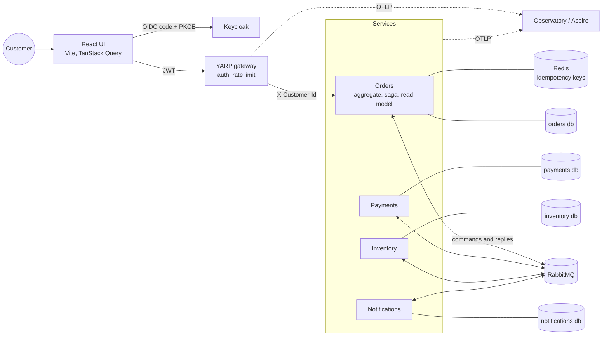
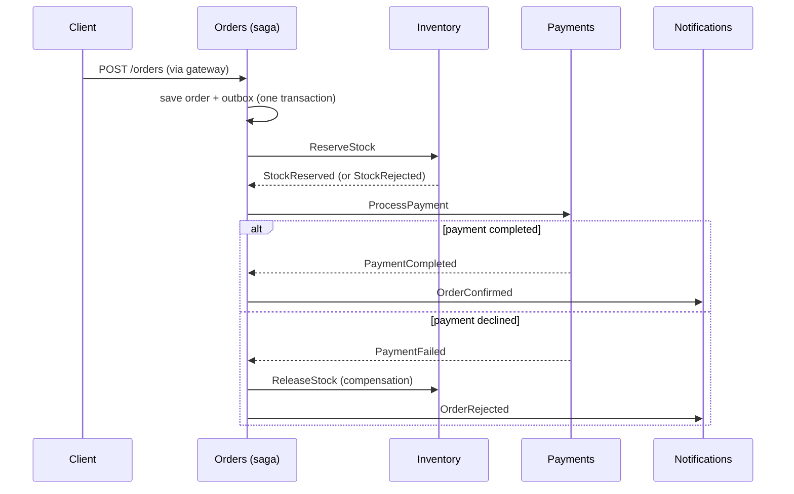

# Orderflow

[](https://github.com/sskobalskyi/orderflow/actions/workflows/ci.yml)
[](https://github.com/sskobalskyi/orderflow/actions/workflows/codeql.yml)

Event-driven order processing built from small .NET services coordinated by a saga. A customer signs in, places an order, and watches it move through stock reservation and payment, or get compensated when something fails. Everything runs locally with one `docker compose up`.


## What it demonstrates

- **Orchestrated saga with compensation:** a MassTransit state machine reserves stock, takes payment and confirms the order. A declined payment releases the stock and rejects the order ([ADR 0002](docs/adr/0002-orchestrated-saga.md)).
- **Transactional outbox and inbox:** state changes and the messages announcing them commit together (EF Core on PostgreSQL), on the HTTP side and inside consumers and the saga. Consumers are idempotent ([ADR 0001](docs/adr/0001-outbox-before-saga.md), [ADR 0004](docs/adr/0004-opentelemetry-and-consumer-outbox.md)).
- **CQRS read model:** every saga step is projected into a timeline the UI queries without touching the saga.
- **API gateway and OIDC:** YARP validates Keycloak JWTs, rate-limits per user and sets the caller identity; services scope all data to it ([ADR 0003](docs/adr/0003-gateway-terminates-auth.md)).
- **Resilience:** exponential retries, `*_error` queues, a replay script, `Idempotency-Key` on order creation backed by Redis, late and duplicate replies ignored by the saga.
- **Database per service:** Orders, Payments, Inventory, Notifications and Catalog each own a database, with EF Core migrations applied on startup.
- **Marketplace base, deliberately generic:** an i18n product catalog (data-driven, swap `products.json` to sell something else), shipping, returns and partial or full refunds that go through Payments. Nothing in it knows what is being sold.
- **Versioned integration events:** `order.confirmed.v1`, `order.shipped.v1`, `order.returned.v1` and `order.refunded.v1` go to the topic exchange `integration.events` as raw JSON with `messageId`, `occurredAt`, `schemaVersion` and `traceparent` headers, through their own transactional outbox. They are a wire contract, separate from the internal saga messages ([ADR 0005](docs/adr/0005-integration-events.md)).
- **Observability:** OpenTelemetry traces, metrics and logs from every service. One order is one trace from the gateway through RabbitMQ to all services, plus a saga dashboard.
- **i18n:** the UI is `en` (default) and `uk`, product names and descriptions included; API errors carry stable codes that the UI translates.
- **UI:** React, Tailwind CSS v4 and shadcn/ui, with a shop, order tracking and an admin tab.
- **Tests:** xUnit for the domain and saga, Testcontainers integration tests against real PostgreSQL, RabbitMQ and Redis, Playwright E2E through the browser and Keycloak login.

## Architecture



### One order, end to end




## Run it

Requirements: Docker. Everything runs locally.

```powershell
docker compose up --build
```

| Service | URL |
| --- | --- |
| Web UI | http://localhost:5173 (sign in as `demo` / `demo` or `alice` / `alice`) |
| API gateway | http://localhost:8080 |
| Keycloak | http://localhost:8180 (`admin` / `admin`) |
| RabbitMQ UI | http://localhost:15672 (`guest` / `guest`) |
| Catalog | http://localhost:8084/products |
| Stock levels | http://localhost:8082/stock |
| Notifications | http://localhost:8083/notifications |

Demo catalog: `LAMP-01` ($25, 100 in stock), `MUG-01` ($12.50, 50) and `DESK-01` ($1200, 5). Payments declines totals above 1000. Sign in as `admin` / `admin` to ship and refund orders.

| Order | Outcome |
| --- | --- |
| 2 x `LAMP-01` | `Confirmed` |
| 1 x `DESK-01` ($1200) | `Rejected` (card declined), stock released |
| 6 x `DESK-01` | `Rejected` (insufficient stock) |

Call the API directly:

```powershell
$token = (curl.exe -s -X POST http://localhost:8180/realms/orderflow/protocol/openid-connect/token `
  -d client_id=orderflow-web -d grant_type=password -d username=demo -d password=demo | ConvertFrom-Json).access_token
curl.exe -X POST http://localhost:8080/api/orders -H "Authorization: Bearer $token" -H "content-type: application/json" `
  -H "Idempotency-Key: $(New-Guid)" -d "{\"lines\":[{\"sku\":\"LAMP-01\",\"quantity\":2}]}"
```

Endpoints, all behind the gateway under `/api`. Prices always come from the catalog, never from the request.

| Endpoint | Who | Purpose |
| --- | --- | --- |
| `GET /products?lang=uk` | anyone | Catalog in a language (falls back to English) |
| `POST /orders`, `GET /orders`, `GET /orders/{id}`, `GET /orders/{id}/timeline` | signed in | Place and track your orders |
| `POST /orders/{id}/return` | the order's owner | Return a shipped order |
| `GET /admin/orders`, `POST /admin/orders/{id}/ship`, `POST /admin/orders/{id}/refund` | `admin` role | Fulfilment and refunds (`{"amount": 10, "reason": "..."}` is optional) |
| `PUT /admin/products/{sku}` | `admin` role | Add or change a product |

An order moves `Submitted` to `Confirmed` (or `Rejected`), then `Shipped`, `Returned` and `Refunded`. A refund can also follow a confirmed order, which acts as a cancellation.

## Activation by a claimed device

Orderflow also *consumes* one event, `device.claimed.v1`. Another system (the Greenhaus API) publishes it when a person links the device they bought, and names the order when the device was sold here. Orderflow marks that shipped order as **in use**: an `Activated` timeline step with the device id, an `activatedAt` on the order and an "In use" badge in the list, in `en` and `uk`. It reads only the order id, the device id and the time, so what the device is stays outside Orderflow. See [ADR 0006](docs/adr/0006-consuming-device-claimed.md).

## Integration events

Other systems consume four events from the topic exchange `integration.events`, with the event name as routing key. Every message is raw JSON, carries the AMQP headers `messageId`, `occurredAt`, `schemaVersion` and `traceparent`, and is delivered at least once, so consumers deduplicate on `messageId`. The schemas live in [`contracts/integration-events.yaml`](contracts/integration-events.yaml), a vendored copy of the AsyncAPI document owned by the Greenhaus repo, and the integration tests validate every published message against it.

| Routing key | Published when |
| --- | --- |
| `order.confirmed.v1` | the saga confirms an order (customer, lines, total, currency) |
| `order.shipped.v1` | an admin marks the order shipped |
| `order.returned.v1` | the customer returns a shipped order |
| `order.refunded.v1` | Payments confirmed a refund (amount, currency, reason) |

## Tests

```powershell
dotnet test                       # unit + Testcontainers integration tests (needs Docker)
cd web; npm test; npm run lint    # unit tests and lint for the UI
docker compose up -d --build; cd web; npm run e2e   # Playwright against the full stack
```

- `tests/Orderflow.Orders.Tests`: domain rules (including the shipping, return and refund transitions) and the saga state machine (MassTransit test harness), including duplicate replies.
- `tests/Orderflow.IntegrationTests`: real PostgreSQL, RabbitMQ and Redis with the five services in-process. Covers the happy path, catalog pricing, compensation, out-of-stock, idempotency, customer isolation, error codes, notifications, and the whole shipping, return and refund lifecycle. A raw AMQP listener, standing in for an outside consumer, validates each published integration event and its headers against the AsyncAPI contract, plus a test that proves the validator fails on a broken payload.
- `web/e2e`: Keycloak login, ordering, the saga timeline, customer isolation, `uk` locale, and the admin flow across two browsers (ship, return, refund). The screenshots in this README come from this suite.

## Selling something else

The catalog and the stock are data, so a deployment sells its own products without code changes. Two files are loaded into empty tables on first start:

- `Catalog:SeedFile`: products with a price, currency and `en` and `uk` texts, as in [`src/Orderflow.Catalog/Seed/products.json`](src/Orderflow.Catalog/Seed/products.json).
- `Inventory:SeedFile`: initial stock, a JSON array such as `[{ "sku": "KIT-01", "available": 50 }]`. Without it the demo stock is used.

Mount both through a compose override and point the settings at them:

```yaml
# docker-compose.shop.yml, used as: docker compose -f docker-compose.yml -f docker-compose.shop.yml up --build
services:
  catalog:
    environment: { Catalog__SeedFile: /seed/products.json }
    volumes: ["./my-shop/products.json:/seed/products.json:ro"]
  inventory:
    environment: { Inventory__SeedFile: /seed/stock.json }
    volumes: ["./my-shop/stock.json:/seed/stock.json:ro"]
```

Both files are only read when their table is empty; use `docker compose down -v` to start over. Orderflow stays generic: it knows SKUs, prices, names and quantities, not what is in the box.

## Observability

Every service exports OpenTelemetry over OTLP when `OTEL_EXPORTER_OTLP_ENDPOINT` is set.

```powershell
# Option A: self-contained, Aspire dashboard on http://localhost:18888
docker compose -f docker-compose.yml -f docker-compose.observability.yml up --build

# Option B: the Observatory lab (Grafana, Tempo, Prometheus, Loki)
(cd ../observatory; docker compose up -d)
docker compose -f docker-compose.yml -f docker-compose.observatory.yml up --build
```

Import [`docs/grafana/orderflow-saga.json`](docs/grafana/orderflow-saga.json) into Grafana for the saga dashboard: orders per minute and outcomes, rejected share, payment and stock results, order duration percentiles, consume latency per service and recent traces.


The first load test through this stack found a real bug: about 6% of orders stayed in `AwaitingStock` because the saga published its command before committing its own state. The fix and the reasoning are in [ADR 0004](docs/adr/0004-opentelemetry-and-consumer-outbox.md).

## Operations

Messages that still fail after retries are parked in `<queue>_error` (see the RabbitMQ UI). After fixing the cause, replay them:

```powershell
./scripts/replay-errors.ps1 -WhatIf   # list what would be replayed
./scripts/replay-errors.ps1           # move every *_error message back to its queue
```

Each service applies its EF Core migrations on startup (`src/*/Migrations`).

## Layout

```
src/Orderflow.Contracts       message contracts shared by services
src/Orderflow.Observability   OpenTelemetry setup and business metrics
src/Orderflow.Gateway         YARP gateway, JWT validation, rate limiting
src/Orderflow.Orders          order aggregate, saga, read model, HTTP API
src/Orderflow.Payments        payment consumer (mock gateway)
src/Orderflow.Inventory       stock and reservations
src/Orderflow.Notifications   customer messages
src/Orderflow.Catalog         i18n product catalog (data-driven seed)
web/                          React + TypeScript UI, Playwright E2E
keycloak/                     imported realm with demo users and an admin role
contracts/                    vendored AsyncAPI contract for the integration events
docs/                         ADRs, Grafana dashboard, images
```

## Known limits

This is a local-first demo, not a production template. returned goods are not restocked, an order can be refunded once, and migrations run on startup instead of through a bundle, the Keycloak realm uses `start-dev`, services trust the gateway on the internal network, and the payment provider is a mock with a fixed limit.

## License

[MIT](LICENSE)
