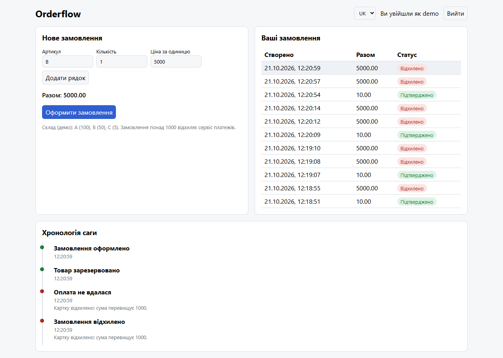
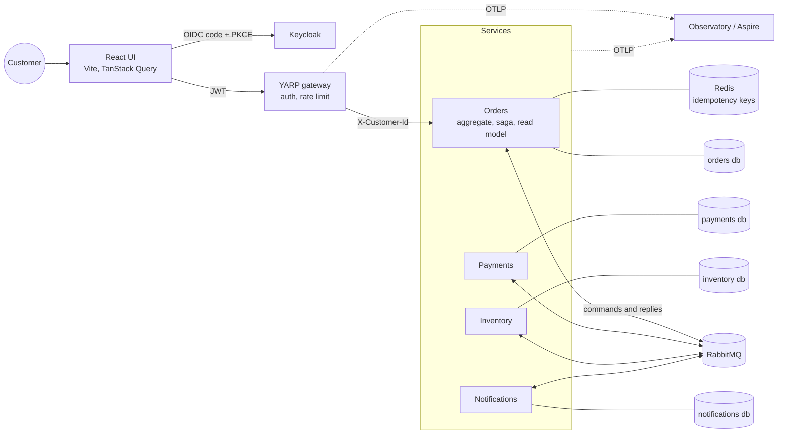
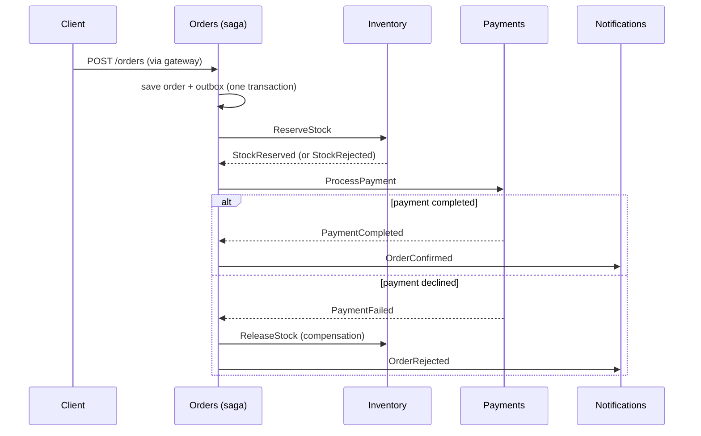
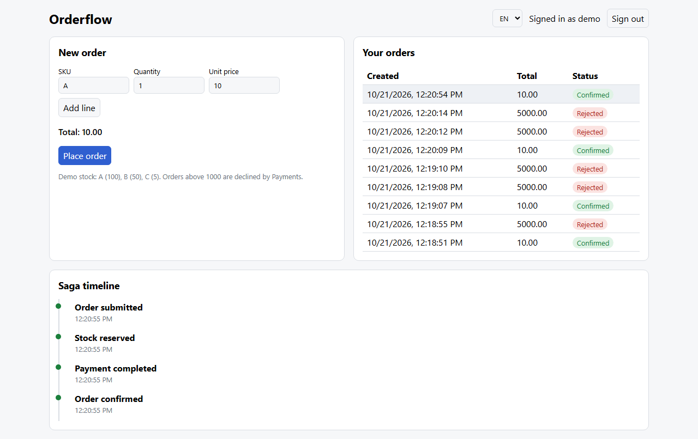
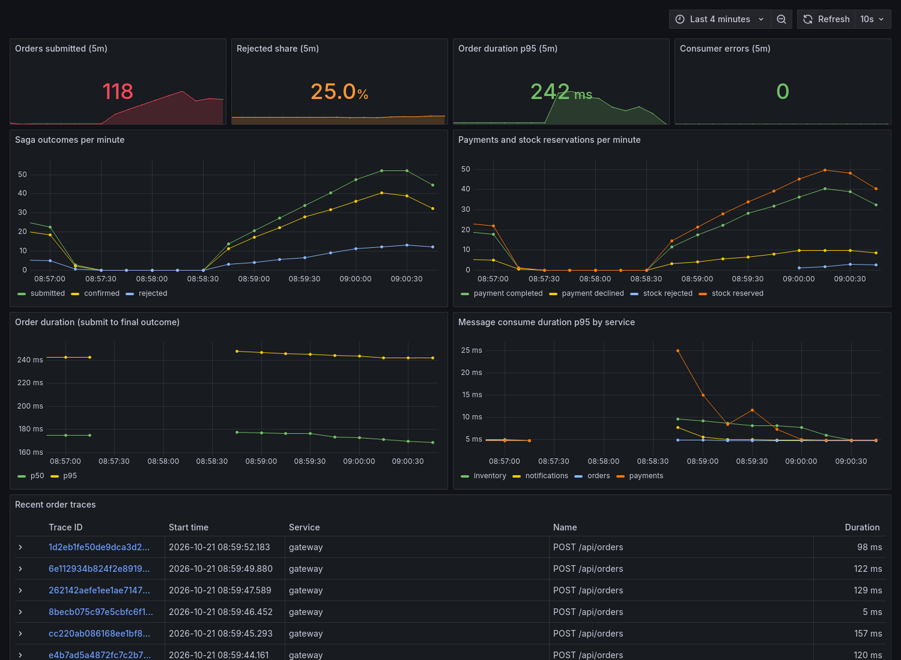

# Orderflow

[](https://github.com/sskobalskyi/orderflow/actions/workflows/ci.yml)
[](https://github.com/sskobalskyi/orderflow/actions/workflows/codeql.yml)

Event-driven order processing built from small .NET services coordinated by a saga. A customer signs in, places an order, and watches it move through stock reservation and payment, or get compensated when something fails. Everything runs locally with one `docker compose up`.



## What it demonstrates

- **Orchestrated saga with compensation:** a MassTransit state machine reserves stock, takes payment and confirms the order. A declined payment releases the stock and rejects the order ([ADR 0002](docs/adr/0002-orchestrated-saga.md)).
- **Transactional outbox and inbox:** state changes and the messages announcing them commit together (EF Core on PostgreSQL), on the HTTP side and inside consumers and the saga. Consumers are idempotent ([ADR 0001](docs/adr/0001-outbox-before-saga.md), [ADR 0004](docs/adr/0004-opentelemetry-and-consumer-outbox.md)).
- **CQRS read model:** every saga step is projected into a timeline the UI queries without touching the saga.
- **API gateway and OIDC:** YARP validates Keycloak JWTs, rate-limits per user and sets the caller identity; services scope all data to it ([ADR 0003](docs/adr/0003-gateway-terminates-auth.md)).
- **Resilience:** exponential retries, `*_error` queues, a replay script, `Idempotency-Key` on order creation backed by Redis, late and duplicate replies ignored by the saga.
- **Database per service:** Orders, Payments, Inventory and Notifications each own a database, with EF Core migrations applied on startup.
- **Observability:** OpenTelemetry traces, metrics and logs from every service. One order is one trace from the gateway through RabbitMQ to all services, plus a saga dashboard.
- **i18n:** the UI is `en` (default) and `uk`; API errors carry stable codes that the UI translates.
- **Tests:** xUnit for the domain and saga, Testcontainers integration tests against real PostgreSQL, RabbitMQ and Redis, Playwright E2E through the browser and Keycloak login.

## Architecture



### One order, end to end





## Run it

Requirements: Docker. Everything runs locally.

```powershell
docker compose up --build
```

| Service | URL |
| --- | --- |
| Web UI | http://localhost:5173 (sign in as `demo` / `demo` or `alice` / `alice`) |
| API gateway | http://localhost:8080 |
| Keycloak | http://localhost:8180 (`admin` / `admin`) |
| RabbitMQ UI | http://localhost:15672 (`guest` / `guest`) |
| Stock levels | http://localhost:8082/stock |
| Notifications | http://localhost:8083/notifications |

Demo stock is A=100, B=50, C=5, and Payments declines totals above 1000:

| Order | Outcome |
| --- | --- |
| 2 x A at 10 | `Confirmed` |
| 1 x B at 5000 | `Rejected` (card declined), stock for B released |
| 9 x C | `Rejected` (insufficient stock) |

Call the API directly:

```powershell
$token = (curl.exe -s -X POST http://localhost:8180/realms/orderflow/protocol/openid-connect/token `
  -d client_id=orderflow-web -d grant_type=password -d username=demo -d password=demo | ConvertFrom-Json).access_token
curl.exe -X POST http://localhost:8080/api/orders -H "Authorization: Bearer $token" -H "content-type: application/json" `
  -H "Idempotency-Key: $(New-Guid)" -d "{\"lines\":[{\"sku\":\"A\",\"quantity\":2,\"unitPrice\":10}]}"
```

Endpoints (all behind the gateway under `/api`): `POST /orders`, `GET /orders`, `GET /orders/{id}`, `GET /orders/{id}/timeline`.

## Tests

```powershell
dotnet test                       # unit + Testcontainers integration tests (needs Docker)
cd web; npm test; npm run lint    # unit tests and lint for the UI
docker compose up -d --build; cd web; npm run e2e   # Playwright against the full stack
```

- `tests/Orderflow.Orders.Tests`: domain rules and the saga state machine (MassTransit test harness), including duplicate replies.
- `tests/Orderflow.IntegrationTests`: real PostgreSQL, RabbitMQ and Redis with the four services in-process. Covers the happy path, compensation, out-of-stock, idempotency, customer isolation, error codes and notifications.
- `web/e2e`: Keycloak login, order, saga timeline, customer isolation, `uk` locale. The screenshots in this README come from this suite.

## Observability

Every service exports OpenTelemetry over OTLP when `OTEL_EXPORTER_OTLP_ENDPOINT` is set.

```powershell
# Option A: self-contained, Aspire dashboard on http://localhost:18888
docker compose -f docker-compose.yml -f docker-compose.observability.yml up --build

# Option B: the Observatory lab (Grafana, Tempo, Prometheus, Loki)
(cd ../observatory; docker compose up -d)
docker compose -f docker-compose.yml -f docker-compose.observatory.yml up --build
```

Import [`docs/grafana/orderflow-saga.json`](docs/grafana/orderflow-saga.json) into Grafana for the saga dashboard: orders per minute and outcomes, rejected share, payment and stock results, order duration percentiles, consume latency per service and recent traces.



The first load test through this stack found a real bug: about 6% of orders stayed in `AwaitingStock` because the saga published its command before committing its own state. The fix and the reasoning are in [ADR 0004](docs/adr/0004-opentelemetry-and-consumer-outbox.md).

## Operations

Messages that still fail after retries are parked in `<queue>_error` (see the RabbitMQ UI). After fixing the cause, replay them:

```powershell
./scripts/replay-errors.ps1 -WhatIf   # list what would be replayed
./scripts/replay-errors.ps1           # move every *_error message back to its queue
```

Each service applies its EF Core migrations on startup (`src/*/Migrations`).

## Layout

```
src/Orderflow.Contracts       message contracts shared by services
src/Orderflow.Observability   OpenTelemetry setup and business metrics
src/Orderflow.Gateway         YARP gateway, JWT validation, rate limiting
src/Orderflow.Orders          order aggregate, saga, read model, HTTP API
src/Orderflow.Payments        payment consumer (mock gateway)
src/Orderflow.Inventory       stock and reservations
src/Orderflow.Notifications   customer messages
web/                          React + TypeScript UI, Playwright E2E
keycloak/                     imported realm with demo users
docs/                         ADRs, Grafana dashboard, images
```

## Known limits

This is a local-first demo, not a production template. Migrations run on startup instead of through a bundle, the Keycloak realm uses `start-dev`, services trust the gateway on the internal network, and the payment provider is a mock with a fixed limit.
