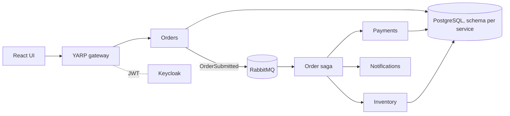

# Orderflow

Event-driven order processing built from small .NET services coordinated by a saga. A portfolio project showing microservices, the transactional outbox, CQRS, an API gateway and OIDC, all running locally in Docker.

> Status: early. The Orders service and its outbox are in place; the saga, Payments, Inventory, Notifications, gateway, Keycloak and the React UI are next.

## Architecture (target)



## Run

```powershell
docker compose up --build
```

| Service | URL |
| --- | --- |
| Orders API | http://localhost:8081 |
| RabbitMQ UI | http://localhost:15672 (guest / guest) |

```powershell
curl -X POST http://localhost:8081/orders -H "content-type: application/json" `
  -d '{"customerId":"11111111-1111-1111-1111-111111111111","lines":[{"sku":"A","quantity":2,"unitPrice":10}]}'
```

## Test

```powershell
dotnet test
```

Decisions are recorded in [docs/adr](docs/adr).

## Roadmap
- [x] Orders service with transactional outbox
- [ ] Order saga (MassTransit state machine)
- [ ] Payments, Inventory, Notifications with inbox idempotency, retries and DLQ
- [ ] CQRS read model, Redis idempotency keys
- [ ] YARP gateway and Keycloak
- [ ] React UI with saga timeline, `en` / `uk`
- [ ] OpenTelemetry into the shared observability stack
