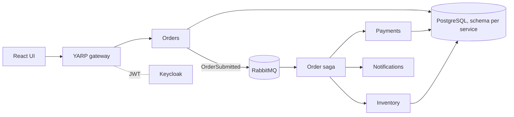

# Orderflow

Event-driven order processing built from small .NET services coordinated by a saga. A portfolio project showing microservices, the transactional outbox, CQRS, an API gateway and OIDC, all running locally in Docker.

> Status: early. Orders, Payments and Inventory run an orchestrated saga with compensation; the React UI is next.

## Architecture (target)



## Run

```powershell
docker compose up --build
```

| Service | URL |
| --- | --- |
| Orders API | http://localhost:8080 (via gateway) |
| RabbitMQ UI | http://localhost:15672 (guest / guest) |

```powershell
# Get a token for the demo user, then call the API through the gateway
$token = (curl.exe -s -X POST http://localhost:8180/realms/orderflow/protocol/openid-connect/token `
  -d client_id=orderflow-web -d grant_type=password -d username=demo -d password=demo | ConvertFrom-Json).access_token
curl.exe -X POST http://localhost:8080/api/orders -H "Authorization: Bearer $token" -H "content-type: application/json" `
  -d "{\"lines\":[{\"sku\":\"A\",\"quantity\":2,\"unitPrice\":10}]}"
```

## Test

```powershell
dotnet test
```

Decisions are recorded in [docs/adr](docs/adr).

## Roadmap
- [x] Orders service with transactional outbox
- [x] Order saga (MassTransit state machine) with stock release on payment failure
- [x] Payments and Inventory with outbox and idempotent consumers
- [x] Notifications service (idempotent), failed messages land in `*_error` queues after retries
- [ ] Replay tooling for `*_error` queues
- [x] CQRS read model (`GET /orders/{id}/timeline`) and Redis `Idempotency-Key` on `POST /orders`
- [x] YARP gateway (JWT, rate limiting, CORS) and Keycloak with demo users `demo` and `alice`
- [ ] React UI with saga timeline, `en` / `uk`
- [ ] OpenTelemetry into the shared observability stack

## Try the saga

Seed stock: A=100, B=50, C=5. Payments declines totals above 1000.

| Order | Outcome |
| --- | --- |
| 2 x A at 10 | `Confirmed` |
| 1 x B at 5000 | `Rejected` (card declined), stock for B released |
| 9 x C | `Rejected` (insufficient stock) |

Stock levels: http://localhost:8082/stock · Notifications: http://localhost:8083/notifications · Timeline: `GET /orders/{id}/timeline`
